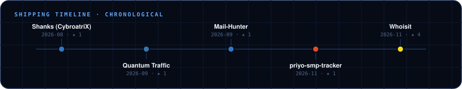
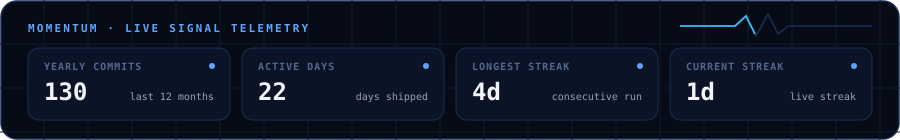
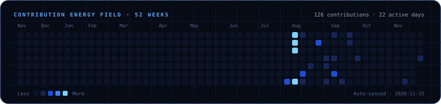

WOW PROFILE · @ITZSTEBIN · LIVE

<picture></picture>

**CSE Student · Developer · Cybersecurity Learner** · Cybroatrix

`Learn -&gt; Build -&gt; Break -&gt; Debug -&gt; Understand -&gt; Improve`

<a href="https://github.com/itzstebin">GitHub</a> · <a href="https://cybroatrix.com">Cybroatrix</a>

✦ ───────────────────────────── ✦

## Identity, with signal

<table width="100%">
  <tr>
    <td width="62%" valign="top">
      
CSE student learning by building, breaking, and shipping — across web apps, cybersecurity &amp; CTFs, local AI experiments, and open-source tools.

      
<strong>Focus:</strong> HTML · TypeScript · JavaScript · Python

      
Beyond code: Chess · Minecraft · Editing &amp; Design · Creative Projects

    </td>
    <td width="38%" valign="top">
      
<code>LIVE SIGNAL</code>

      

        <strong>8</strong> repositories 
        <strong>11</strong> stars 
        <strong>127</strong> contributions 
        <strong>3</strong> followers
      

    </td>
  </tr>
</table>

✦ ───────────────────────────── ✦

## What moves the work

<picture></picture>

Built in public — learning by shipping, breaking, and refining.

✦ ───────────────────────────── ✦

## The tools behind the signal

<picture></picture>

HTML · TypeScript · JavaScript · Python · CSS · Kotlin · chosen for the problem, not the hype

✦ ───────────────────────────── ✦

## Built, shipped, shared

<picture></picture>

<picture></picture>

<table width="100%">
  <tr>
    <td width="25%" valign="top">
      
<strong><a href="https://github.com/itzstebin/Whoisit">Whoisit</a></strong>

      
Privacy-first Instagram follower and following checker. Runs locally in your browser with no p…

      
JavaScript · ⭐ 4

    </td>
    <td width="25%" valign="top">
      
<strong><a href="https://github.com/itzstebin/priyo-smp-tracker">priyo-smp-tracker</a></strong>

      
Live Auction House browser, candlestick price graphs, and flipping radar for Priyo SMP.

      
HTML · ⭐ 1

    </td>
    <td width="25%" valign="top">
      
<strong><a href="https://github.com/itzstebin/Mail-Hunter">Mail-Hunter</a></strong>

      
React/Vite investigation workspace + native Kotlin Android app backed by Firebase &amp; Gmail Watc…

      
TypeScript · ⭐ 1

    </td>
    <td width="25%" valign="top">
      
<strong><a href="https://github.com/itzstebin/Shanks">Shanks (CybroatriX)</a></strong>

      
CybroatriX web platform built with React, TypeScript, Vite, Framer Motion, and Firebase.

      
TypeScript · ⭐ 1

    </td>
  </tr>
</table>

✦ ───────────────────────────── ✦

## Momentum, made visible

<picture></picture>

✦ ───────────────────────────── ✦

## The trail behind the work

<picture></picture>

1 day current streak · 4 day longest streak · 22 active days

<b>✨ 3D Contribution Skyline &amp; Contribution Snake (Auto-Updated)</b>

✦ ───────────────────────────── ✦

KEEP THE SIGNAL MOVING

## Make something worth noticing

Always open to building useful tools, cybersecurity research, and creative software.

<a href="https://github.com/itzstebin">GitHub (@itzstebin)</a> · <a href="https://cybroatrix.com">Cybroatrix</a>

Wow Profile · living identity · auto-updated from GitHub · auto-updated via GitHub Actions on 2026-11-25

