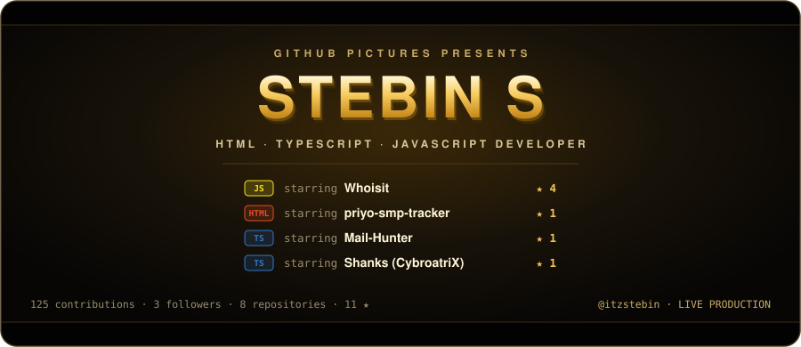
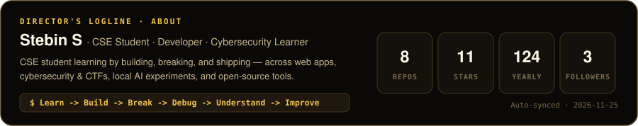
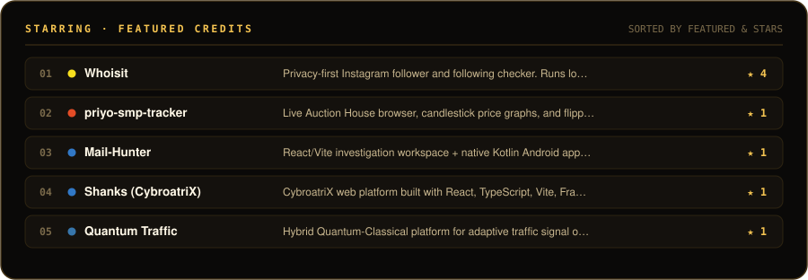
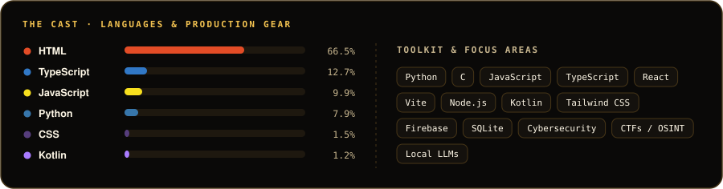
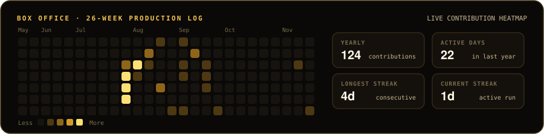
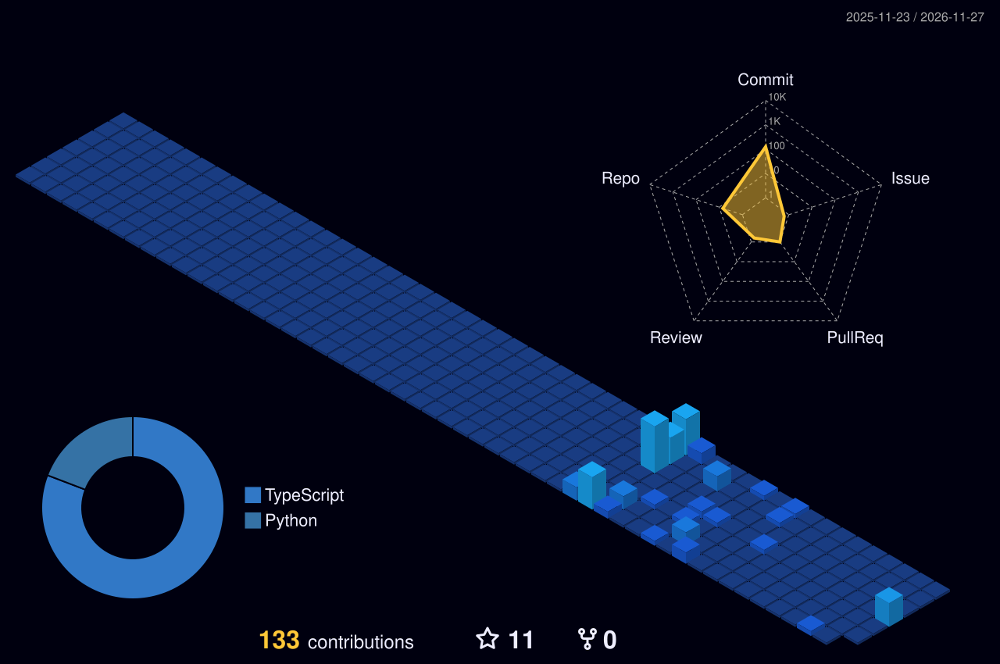

<picture></picture>

<picture></picture>

<picture></picture>

<a href="https://github.com/itzstebin/Whoisit">Whoisit</a> · <a href="https://github.com/itzstebin/priyo-smp-tracker">priyo-smp-tracker</a> · <a href="https://github.com/itzstebin/Mail-Hunter">Mail-Hunter</a> · <a href="https://github.com/itzstebin/Shanks">Shanks (CybroatriX)</a> · <a href="https://github.com/itzstebin/Quantum-Enhanced-Adaptive-Urban-Traffic-Optimization">Quantum Traffic</a> · <a href="https://github.com/itzstebin/Guess-the-Number-Game">Guess-the-Number</a>

<picture></picture>

<picture></picture>

---

### 🚀 What I'm Building & Exploring

- **[Cybroatrix](https://cybroatrix.com)** `Cybersecurity & Tech` — My technology and cybersecurity project focused on networking, web security, and technical education.
- **BingeHub** `React · HLS · IPTV` — A streaming and media interface experiment exploring search, M3U playlists, and browser-based HLS playback.
- **Local AI Experiments** `PyTorch · LLMs` — Character-level models, memory-based chatbots, and training experiments running language systems locally.

**Beyond Code:** Chess · Minecraft · Editing & Design · Creative Projects

<b>✨ 3D Contribution Skyline &amp; Contribution Snake (Auto-Updated)</b>

---

<a href="https://github.com/itzstebin">GitHub (@itzstebin)</a> · <a href="https://cybroatrix.com">Cybroatrix</a>

Title Sequence · now showing · starring live repositories · auto-updated via GitHub Actions on 2026-11-25

